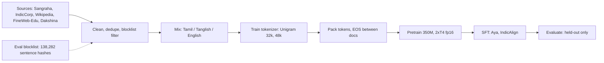
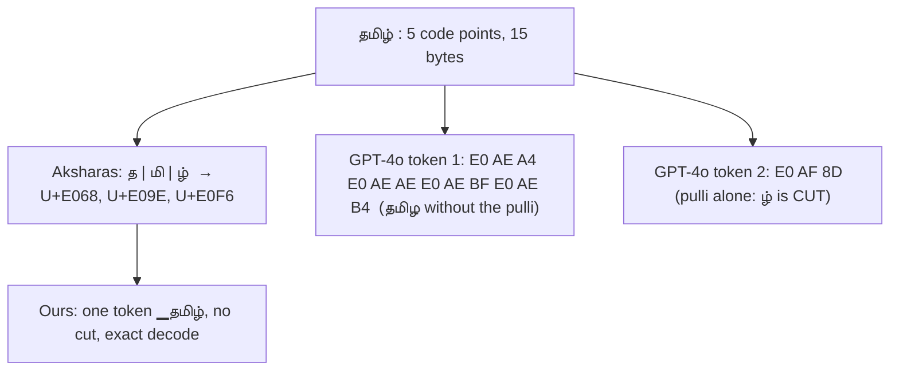
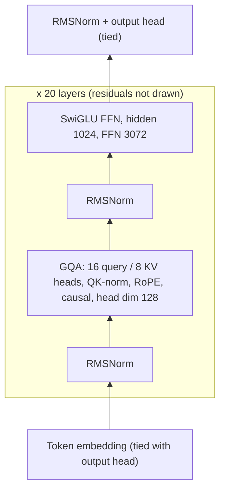
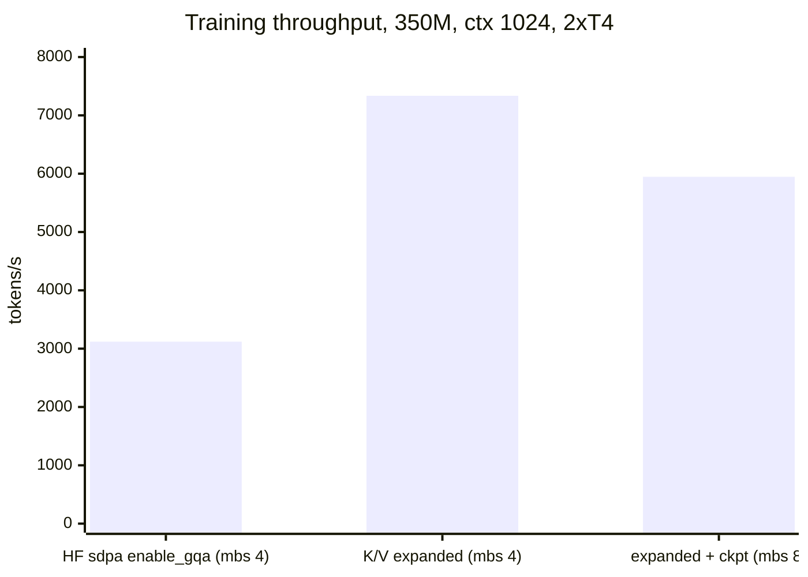

# Akshara-Aware Tokenization for Tamil, Tanglish and English: Fewer Tokens, No Broken Letters, and a Small Language Model Built on It

*Anonymous submission. Markdown copy of `main.tex`. Cells marked **PENDING** are not measured yet. The LaTeX file is the source of truth.*

## Abstract

Byte-level tokenizers split Tamil letters. A Tamil letter (akshara) is one to three Unicode code points, and each code point takes three bytes in UTF-8. A merge can therefore end between a consonant and its vowel sign or its pulli, and the token then holds half a letter.

We map every Tamil akshara (312 units) to one Private Use Area (PUA) code point inside the tokenizer's normalizer, train a Unigram model on the mapped text with byte fallback, and map back on decode. No learned token can cut a letter, and decoding is exact. We train 32k and 48k vocabularies on a mix of Tamil, synthetic and real romanized Tamil (Tanglish), and English.

In a small SMOKE test (28 prose lines from one Tamil Wikipedia article, not a benchmark), the 48k tokenizer uses 2.07 tokens per word with 0% cut letters; Gemma 3 uses 2.60 with 11.5%, Sarvam-1 2.65 with 13.8%, and GPT-4o 7.65 with 40.5%. On 2,000 held-out documents per set, the 32k tokenizer uses 2.26 tokens per Tamil word against 2.67 for Gemma 3 and Gemma 4 (262k vocabulary) and 7.61 for GPT-4o, with 0% cut letters against 7.6-58.8%. A Tamil-first 64k tokenizer (Agaram 2.5B) uses fewer Tamil tokens (1.91) but cuts 15.9% of letters, and ours is lower on real Tanglish. A controlled tokenizer ablation and a 350M-parameter Qwen3-style model trained on this tokenizer are specified here and not yet run. We also report one measured engineering result: on Tesla T4 GPUs, expanding grouped-query K/V heads before attention made training 2.35x faster (3,120 to 7,336 tokens/s).

## 1 Introduction

Tamil is written in an abugida. A letter is a consonant, optionally followed by a vowel sign or a pulli (the dot that removes the inherent vowel). In Unicode, one letter is one to three code points, and each code point is three bytes in UTF-8. The word தமிழ் ("Tamil") is three letters, five code points and 15 bytes.

Byte-level BPE vocabularies know nothing about letters (Sennrich et al., 2016; Kudo and Richardson, 2018). Because they work on bytes or code points, a token boundary can fall between a consonant and its vowel sign. Figure 2 shows this for GPT-4o's public tokenizer: the pulli of ழ் is a separate token. A token that holds half a letter has no meaning of its own, so the model must learn to put letters back together. Prior work shows that tokenizers give unequal costs and unequal quality across languages (Rust et al., 2021; Petrov et al., 2023; Ahia et al., 2023).

We do not assume the largest tokenizers are bad. Some public vocabularies are large (Gemma 3 has 262k entries) and treat Tamil far better than older ones. We measure the public ones we can load, and say so where we cannot. Our claim is narrower: a 32k–48k vocabulary can beat much larger multilingual vocabularies on Tamil, never cut a letter, and be rebuilt from public data by anyone with a free GPU quota.

**Contributions.** Each is tied to its evidence.

- **C1. Akshara-safe tokenizer.** A normalizer maps each of 312 Tamil units to one PUA code point (Section 3, Figure 2). Cut-letter rate is 0% by construction and 0% in the SMOKE test (Table 1).
- **C2. Fewer tokens at a smaller vocabulary than multilingual tokenizers.** On 2,000 held-out documents, 2.26 Tamil tokens per word at 32k against 2.67 for Gemma 3/4 (262k), with 0% cut letters (Table 2). A Tamil-first 64k tokenizer (Agaram) uses fewer Tamil tokens but cuts 15.9% of letters.
- **C3. Controlled ablation** against the Llama 3 tokenizer, same model and same bytes: **PENDING** (Table 3).
- **C4. A 350M model** trained from scratch on the tokenizer, with bits-per-byte and four labeled Tamil tasks: **PENDING** (Table 4).
- **C5. A measured T4 attention finding**: expanding K/V heads before SDPA gives 2.35x throughput (Section 6, Table 5, Figure 4).
- **C6. Open pipeline with contamination control**: a sentence-hash blocklist of 138,282 hashes over all evaluation and held-out text (Section 3).

**Figure 1. Pipeline.**

The blocklist is built from every evaluation and held-out text before any training text is read. (SVG: `figures/fig1_pipeline.svg`)

## 2 Related Work

**Subword tokenization.** BPE (Sennrich et al., 2016) and the Unigram language model (Kudo, 2018) are the standard subword methods; SentencePiece packages both (Kudo and Richardson, 2018). We use the Unigram trainer from Hugging Face `tokenizers`, and add a normalizer that changes what a "character" is for Tamil.

**Tokenizer fairness and cost.** Rust et al. (2021) link tokenizer quality to monolingual performance. Petrov et al. (2023) and Ahia et al. (2023) show large differences in token counts for the same content across languages. We follow their use of tokens per word as a cost measure, and add a measure for broken letters.

**Indic resources.** IndicCorp (Kakwani et al., 2020), IndicBERT v2 and IndicXTREME (Doddapaneni et al., 2023), and IndicLLMSuite with Sangraha and IndicAlign (Khan et al., 2024) supply our text. IndicXNLI (Aggarwal et al., 2022), Belebele (Bandarkar et al., 2024) and Aksharantar (Madhani et al., 2022) supply evaluation. Dakshina (Roark et al., 2020) supplies real romanized Tamil. Aya (Singh et al., 2024) supplies instruction data.

**Public frontier-family tokenizers.** We can measure only tokenizers that are public: GPT-4o's (OpenAI, 2024) through a public mirror, and the Gemma family (Gemma Team, 2024, 2025), Llama 3 (Llama Team, 2024) and Qwen (Yang et al., 2025) through their released files. We make no claim about tokenizers of hosted models that are not public.

**Tamil-first models.** Agaram 2.5B (Kumaresan et al., 2026) is a Tamil-English model trained from scratch on 50B tokens with its own 64k byte-level BPE tokenizer. It is the closest prior work; we measure its tokenizer in Table 2.

**Training efficiency.** Memory-efficient attention (Rabe and Staats, 2021) and FlashAttention (Dao et al., 2022) avoid storing the full score matrix. GQA (Ainslie et al., 2023) shares K/V heads across query heads. ZeRO (Rajbhandari et al., 2020) shards optimizer state. Section 6 shows how GQA interacts with kernel choice on T4.

## 3 Method

### 3.1 Akshara-to-PUA mapping

**Segmentation.** After NFC normalization, a regular expression finds each akshara: a consonant with an optional vowel sign or pulli, a vowel, or the aytham. We enumerate all vowels, the aytham, and for each consonant the bare consonant, the consonant with pulli, and the consonant with each vowel sign. This gives 312 units. Each unit gets one code point in the Private Use Area, starting at U+E000.

**In the tokenizer.** The normalizer is NFC followed by one `Replace` per unit (longest unit first). After that, a letter is a single character, so the Unigram trainer can only build pieces from whole letters. The pre-tokenizer is Metaspace plus individual digits. The model has 256 byte-fallback pieces (`<0xNN>`) for characters outside the alphabet. The decoder maps pieces back: replace the space marker, resolve byte pieces, fuse, replace each PUA code point with its original code points, strip one leading space.

**Worked example.** தமிழ் is U+0BA4 U+0BAE U+0BBF U+0BB4 U+0BCD. Our segmentation gives த | மி | ழ், which map to U+E068, U+E09E, U+E0F6. GPT-4o's tokenizer (`Xenova/gpt-4o`, loaded with `tokenizers`) gives two tokens: the bytes `E0 AE A4 E0 AE AE E0 AE BF E0 AE B4` and `E0 AF 8D`. The second token is the pulli alone, so ழ் is cut. Our 32k and 48k tokenizers encode the same word as one token, `▁தமிழ்` (checked by running the trained tokenizers; decoding returns the exact input). This is one word, shown to explain the mechanism, and is not evidence of average behavior.

**Figure 2. The same word under GPT-4o's tokenizer and ours.**

(SVG: `figures/fig2_akshara_pua.svg`)

### 3.2 Tokenizer training

Unigram, vocabulary 32,000 and 48,000, `max_piece_length` 16, initial alphabet equal to the 312 PUA code points. The 256 byte pieces are added after training, so the final size equals the target (both reached it exactly). The training sample is about 1 GB with a mix of 45% Tamil, 25% Tanglish and 30% English by characters (the build script defaults to 2 GB and reads a size override). We pick 48k over 32k only if Tamil tokens per word falls by at least 8%; this rule is fixed before the benchmark is run.

### 3.3 Tanglish synthesis

Romanized Tamil has no standard spelling. We romanize Tamil documents with three schemes (`iso`, `casual`, `chat`) and seeded noise: variant spellings (`zh`/`l`/`z`, `th`/`t`/`d`, long vowels shortened), doubled letters collapsed and a dropped final `u`. In the mix, 80% of Tanglish documents are synthesized from Tamil and the rest are real romanized text from Dakshina (Roark et al., 2020).

### 3.4 Data and contamination control

Pretraining text: Sangraha verified Tamil (Khan et al., 2024), IndicCorp v2 Tamil (Kakwani et al., 2020), Tamil Wikipedia except its first 2,000 articles, FineWeb-Edu English (Penedo et al., 2024), and the Dakshina dev romanized split. Cleaning keeps documents of at least 50 characters, at least 70% letters in the expected script, and at most 30% repeated lines; exact duplicates (hash of normalized text) are dropped. We do not run near-duplicate detection.

Held out and never trained on: the first 2,000 Tamil Wikipedia articles, English Wikipedia, and the Dakshina test split (fertility and bits-per-byte); IndicXNLI, IndicSentiment, IndicQA, Belebele-ta and Aksharantar (labeled). For all of them we hash every sentence of at least 12 characters (NFC, lowercased, whitespace-normalized, 64-bit BLAKE2b) into a blocklist of 138,282 hashes. Any training document containing a blocked sentence is dropped. SFT uses Aya (Tamil) (Singh et al., 2024) and IndicAlign (Khan et al., 2024) through the same blocklist.

## 4 Experimental Setup

**Baselines.** GPT-4o (o200k, `Xenova/gpt-4o`), Llama 3 (`unsloth/Llama-3.2-1B`), Gemma 2 (`unsloth/gemma-2-2b`), Gemma 3 (`unsloth/gemma-3-1b-it`), Qwen2.5 (`Qwen/Qwen2.5-0.5B`), mT5 (`google/mt5-small`), IndicBERT v2 (`ai4bharat/IndicBERTv2-MLM-only`) and Sarvam-1 (`sarvamai/sarvam-1`). A baseline that fails to load is reported as skipped (Qwen3 failed in the SMOKE run).

**Tokenizer metrics.** *Tokens per word*: tokens over whitespace-separated words (lower is better). *Bytes per token*. *Cut-letter rate*: share of tokens whose first character is a Tamil vowel sign or pulli, so the token starts in the middle of a letter. For our tokenizers we read token text after mapping PUA back, since offsets point at the last code point of an akshara. *Round-trip*: decode(encode(x)) equals NFC(x) exactly. Held-out sets: Tamil Wikipedia (2,000 documents, at most 2,000 characters each), synthetic Tanglish made from them, real Tanglish (Dakshina test), English Wikipedia.

**Bits per byte.** Total negative log-likelihood in bits divided by UTF-8 bytes of the text, so models with different tokenizers are comparable. Documents are scored in chunks of 1,024 tokens.

**Labeled tasks.** IndicXNLI, IndicSentiment, Belebele-ta: 5-shot, length-normalized log-likelihood per answer byte, shots taken from the head of each test set and excluded from scoring, at most 500 items. Aksharantar: Latin-to-Tamil transliteration exact match. Prompt wording is ours and fixed in the code. IndicQA is blocklisted but has no scoring code yet.

**Model.** Qwen3-style (Yang et al., 2025) dense decoder, about 350M parameters: hidden size 1024, 20 layers, 16 query heads, 8 KV heads, head dim 128, FFN 3072 with SwiGLU (Shazeer, 2020), RoPE (Su et al., 2021) with base 1,000,000, QK-norm, tied embeddings, context 1,024. We chose it because QK-norm helps fp16 stability on T4, which has no bf16.

**Figure 3. Decoder block.**

(SVG: `figures/fig3_architecture.svg`)

**Training.** fp16 with loss scaling, 2xT4 on Kaggle, DDP, ZeRO-1 optimizer sharding (Rajbhandari et al., 2020), chunked cross-entropy (2,048 tokens per chunk). AdamW (beta 0.9, 0.95), weight decay 0.1, peak LR 6e-4, cosine to 6e-5, 500 warmup steps, gradient clip 1.0. Micro-batch 4, accumulation 32, so 262,144 tokens per step. Planned budget about 1.5B tokens, below the compute-optimal size for this model (Hoffmann et al., 2022); the model is under-trained on purpose. Training resumes across Kaggle's 12-hour sessions. Single run, one seed.

## 5 Results

### 5.1 Smoke test (not the benchmark)

Table 1 is a quick check on 28 Tamil prose lines from one Tamil Wikipedia article with wiki markup stripped. It has one article, no confidence interval and no Tanglish or English. It shows that the pipeline runs and what size of difference to look for. It does not support a general claim.

**Table 1. SMOKE test: 28 lines, one article. Not the benchmark. Qwen3 failed to load and is skipped.**

| Tokenizer | Tok/word | Cut letters | Round-trip |
|---|---:|---:|---:|
| Ours 48k | 2.07 | 0% | 100% |
| Ours 32k | 2.19 | 0% | 100% |
| Gemma 3 (262k vocab) | 2.60 | 11.5% | 100% |
| Sarvam-1 | 2.65 | 13.8% | 100% |
| Gemma 2 | 4.23 | 20.8% | 100% |
| GPT-4o (o200k) | 7.65 | 40.5% | 100% |

On these lines, ours-48k uses 20.4% fewer tokens than Gemma 3 and 21.9% fewer than Sarvam-1; ours-32k uses 15.8% and 17.4% fewer (arithmetic on Table 1). Gemma 3's vocabulary is 5.5 times larger than our 48k and 8.2 times larger than our 32k. Gemma 3 is far better than GPT-4o here (2.60 against 7.65) but is still about 2.6 tokens per word, and 11.5% of its tokens start inside a letter. We read this as: a recent large public vocabulary closes most of the gap with older tokenizers, and the remaining difference is the broken letters and a modest token saving. Whether the saving holds on 2,000 documents is the question for Table 2.

### 5.2 Fertility benchmark

**Table 2. Fertility on 2,000 held-out documents per set** (first 2,000 non-empty articles of Tamil and English Wikipedia 20231101; Dakshina Tamil test split for real Tanglish; synthetic Tanglish is our romanizer applied to the Tamil set). mT5 was not measured (its SentencePiece model failed to load). Gemma 3 and Gemma 4 give identical numbers. Source: `reports/fertility.md`, `reports/fertility_agaram.md`, `reports/fertility_lfm.md`. LFM2.5 2.6B and LFM3 1.7B give identical numbers.

| Tokenizer | Vocab | Tamil tok/word | Tanglish (synth) | Tanglish (real) | English | Tamil bytes/tok | Tamil cut letters | Round-trip |
|---|---|---|---|---|---|---|---|---|
| Ours 32k | 32,000 | 2.26 | 2.48 | 2.86 | 1.73 | 10.73 | 0.0% | 100.0% |
| Ours 48k | 48,000 | 2.13 | 2.32 | 2.70 | 1.64 | 11.38 | 0.0% | 100.0% |
| Agaram 2.5B | 64,000 | 1.91 | 3.30 | 3.04 | 1.55 | 12.67 | 15.9% | 100.0% |
| LFM2.5 1.2B | 64,402 | 18.61 | 4.09 | 4.06 | 1.43 | 1.30 | 16.4% | 100.0% |
| Sarvam-1 | 68,096 | 2.70 | 4.75 | 4.67 | 1.72 | 8.97 | 11.5% | 100.0% |
| LFM2.5 2.6B | 125,017 | 5.18 | 3.90 | 3.91 | 1.40 | 4.68 | 58.8% | 100.0% |
| LFM3 1.7B | 125,033 | 5.18 | 3.90 | 3.91 | 1.40 | 4.68 | 58.8% | 100.0% |
| Llama 3 | 128,256 | 11.94 | 3.93 | 3.93 | 1.40 | 2.03 | 25.5% | 100.0% |
| Qwen2.5 | 151,665 | 9.74 | 4.03 | 3.99 | 1.44 | 2.49 | 31.3% | 100.0% |
| GPT-4o (o200k) | 200,000 | 7.61 | 3.62 | 3.54 | 1.42 | 3.19 | 40.0% | 100.0% |
| IndicBERT v2 | 250,000 | 1.88 | 2.91 | 2.86 | 1.37 | 12.92 | 7.6% | 0.1% |
| Gemma 2 | 256,000 | 4.33 | 3.64 | 3.55 | 1.40 | 5.60 | 21.8% | 100.0% |
| Gemma 3 | 262,145 | 2.67 | 3.60 | 3.53 | 1.41 | 9.09 | 11.4% | 100.0% |
| Gemma 4 | 262,144 | 2.67 | 3.60 | 3.53 | 1.41 | 9.09 | 11.4% | 100.0% |

On 2,000 documents per set, ours-32k uses 2.26 Tamil tokens per word: 15.4% fewer than Gemma 3/4 (2.67), 16.3% fewer than Sarvam-1 (2.70) and 70% fewer than GPT-4o (7.61), at one eighth of Gemma's vocabulary and with 0% cut letters against 7.6-58.8% for every baseline. Two baselines need care. Agaram 2.5B, a Tamil-first tokenizer with 64k entries, uses fewer Tamil tokens than ours (1.91 against 2.26 at 32k and 2.13 at 48k), but 15.9% of its tokens start inside a letter; on real Tanglish ours is lower (2.86 against 3.04). IndicBERT v2 uses the fewest Tamil tokens (1.88) but reproduces only 0.1% of documents exactly, so it cannot serve a generative model. Liquid AI's LFM tokenizers, used by small on-device models, are the weakest recent ones on Tamil: 18.61 tokens per Tamil word for LFM2.5 1.2B and 5.18 for LFM3 1.7B and LFM2.5 2.6B (which share one tokenizer), with 58.8% of tokens starting inside a letter for the latter. On English our tokenizers are worse than every large vocabulary (1.73 at 32k against 1.37-1.55). The 48k vocabulary is 5.7% lower than 32k on Tamil; our pre-registered rule required 8%, so we train the model on 32k.

### 5.3 Tokenizer ablation (pending)

Same model size, same shards (same UTF-8 bytes), one epoch each, our tokenizer against the Llama 3 tokenizer. The comparison is on bits per byte because token counts differ.

**Table 3. Ablation, equal bytes.** Model size (30M or 350M), shard count and tokens seen: PENDING. PENDING (run: `kaggle/03_ablation.py`, then `kaggle/04_eval.py`).

| Tokenizer | BPB Tamil | BPB Tanglish | BPB English |
|---|---|---|---|
| Ours | PENDING | PENDING | PENDING |
| Llama 3 | PENDING | PENDING | PENDING |

### 5.4 350M model (pending)

**Table 4. Bits per byte and labeled tasks, 5-shot, at most 500 items.** PENDING (run: `kaggle/02_train.py`, `kaggle/05_sft.py`, `kaggle/04_eval.py`). No same-size baseline model has been chosen yet.

| Model | BPB Tamil | BPB Tanglish | BPB English | IndicXNLI acc. | IndicSentiment acc. | Belebele-ta acc. | Aksharantar exact match |
|---|---|---|---|---|---|---|---|
| Ours 350M (pretrained) | PENDING | PENDING | PENDING | PENDING | PENDING | PENDING | PENDING |
| Ours 350M (+ SFT) | PENDING | PENDING | PENDING | PENDING | PENDING | PENDING | PENDING |
| Chance (3, 2, 4 choices) | – | – | – | 33.3 | 50.0 | 25.0 | – |

## 6 Engineering Note: GQA Attention on T4

**Setting.** Measured on Kaggle 2xT4 with random tokens, the 350M model and context 1,024. These are throughput numbers; no model quality is involved.

**Finding.** Hugging Face `transformers` with the `sdpa` backend passes `enable_gqa=True` to PyTorch's scaled dot-product attention when there is no attention mask, which is the case in packed pretraining. On T4, the memory-efficient kernel rejected that call ("No available kernel"), so PyTorch ran the math kernel, which stores a full sequence-by-sequence score grid per head. Throughput was 3,120 tokens/s, and micro-batch 4 ran out of memory without activation checkpointing. We replaced the attention function with one that repeats K/V heads to match the query heads and calls SDPA without the flag. The memory-efficient kernel then ran: 7,336 tokens/s at micro-batch 4, 2.35 times faster, with no checkpointing.

**Table 5. Measured throughput, 350M, ctx 1,024, 2xT4, random tokens. One run per row.**

| Setup | Micro-batch | Tokens/s |
|---|---:|---:|
| HF `sdpa`, `enable_gqa` (math kernel) | 4 | 3,120 (OOM without checkpointing) |
| + chunked loss + ZeRO-1 only | – | 3,058 |
| K/V expanded before SDPA | 4 | **7,336** |
| K/V expanded + checkpointing | 8 | 5,947 |

Chunked loss and ZeRO-1 alone gave no gain (3,058 tokens/s); they are there to save memory, not time. Expanding K/V costs extra memory traffic, but this was far cheaper than the math kernel. At 7,336 tokens/s, 1.5B tokens take about 57 hours (1.5e9 / 7,336 / 3,600), if the rate is the total over both GPUs. Our measurement is on T4 with one PyTorch version; we do not claim it holds on other GPUs, where the kernel selection rules may differ.

**Figure 4. Throughput by attention setup (tokens/s).**

(SVG: `figures/fig4_attention_throughput.svg`)

## 7 Analysis and Discussion

Analysis that depends on pending results waits for them: (i) whether lower cut-letter rate gives lower bits per byte in the ablation; (ii) where the 350M model sits against chance on the labeled tasks. We will write each only after its table is filled.

The claim is meant to hold whatever the full benchmark shows about frontier tokenizers: comparable or better fertility at a 32k–48k vocabulary (5–8 times smaller than a 262k vocabulary), no broken letters, and an open pipeline. If a public tokenizer beats ours on tokens per word, the cut-letter rate and the vocabulary size remain the differences to report.

## 8 Conclusion

We map Tamil letters to single code points so that a standard Unigram tokenizer cannot cut them. On 2,000 held-out documents it uses fewer Tamil tokens than every multilingual tokenizer we measured, at a fraction of their vocabulary, with no broken letters; the model-level evaluation is specified, and we report one measured training-speed result for T4 GPUs.

## Limitations

- **Results are mostly pending.** The fertility benchmark (Table 2) is measured; the ablation and model scores are not run.
- **Leading space is lost on decode.** The decoder strips one leading space, so text that starts with a space does not round-trip. Our round-trip metric compares to NFC text without that case.
- **Offsets are coarse.** Because the normalizer replaces several code points with one, character offsets point to an akshara's last code point. We compute cut letters from token text instead.
- **Synthetic Tanglish is not chat Tanglish.** It is rule-based romanization with noise. Real romanized text is only the Dakshina set.
- **One language.** The mapping is Tamil-specific. Other abugidas would need their own tables.
- **Small model, small budget.** 350M parameters, about 1.5B tokens, one run, one seed. Results will not transfer to large models.
- **Fertility is not quality.** Fewer tokens per word helps cost and context length, but is not shown to help understanding until the ablation runs.
- **Compute and platform.** The speed finding is for T4 and one software stack. Near-duplicates are not removed. Licences were taken from our source table and not re-checked.

## Ethical Considerations

All text comes from public datasets used under their stated licences: Sangraha (CC BY 4.0), IndicCorp v2 (CC0), Tamil and English Wikipedia (CC BY-SA 3.0), FineWeb-Edu (ODC-By), Dakshina (CC BY-SA 4.0), Aya (Apache 2.0), IndicAlign (CC BY 4.0), IndicXNLI and IndicSentiment (CC0), IndicQA and Aksharantar (CC BY 4.0), Belebele (CC BY-SA 4.0). These strings are from our source table and must be checked against each dataset page before release. Share-alike terms of Wikipedia and Dakshina may apply to released derivatives, so we will state the terms in the model card. We collected no personal data and ran no human study. Web text may contain personal or offensive content that our filters do not remove. A model this small can write fluent but false Tamil, and a tokenizer reduces cost for one language only, which does not make a system fair to its speakers. AI assistants were used in drafting this paper and the code; all numbers come from logged runs.

## References

Full entries with arXiv ids or ACL Anthology DOIs are in `references.bib`.

- Aggarwal, Gupta, Kunchukuttan (2022). IndicXNLI. arXiv:2204.08776.
- Ahia et al. (2023). Do All Languages Cost the Same? arXiv:2305.13707.
- Ainslie et al. (2023). GQA. arXiv:2305.13245.
- Bandarkar et al. (2024). The Belebele Benchmark. arXiv:2308.16884.
- Dao et al. (2022). FlashAttention. arXiv:2205.14135.
- Doddapaneni et al. (2023). Towards Leaving No Indic Language Behind. arXiv:2212.05409.
- Gemma Team (2024). Gemma 2. arXiv:2408.00118. Gemma Team (2025). Gemma 3. arXiv:2503.19786.
- Hoffmann et al. (2022). Training Compute-Optimal Large Language Models. arXiv:2203.15556.
- Kakwani et al. (2020). IndicNLPSuite. doi:10.18653/v1/2020.findings-emnlp.445.
- Khan et al. (2024). IndicLLMSuite. arXiv:2403.06350.
- Kudo (2018). Subword Regularization. arXiv:1804.10959. Kudo and Richardson (2018). SentencePiece. arXiv:1808.06226.
- Llama Team (2024). The Llama 3 Herd of Models. arXiv:2407.21783.
- Madhani et al. (2022). Aksharantar. arXiv:2205.03018.
- OpenAI (2024). GPT-4o System Card. arXiv:2410.21276.
- Penedo et al. (2024). The FineWeb Datasets. arXiv:2406.17557.
- Petrov et al. (2023). Language Model Tokenizers Introduce Unfairness Between Languages. arXiv:2305.15425.
- Rabe and Staats (2021). Self-attention Does Not Need O(n^2) Memory. arXiv:2112.05682.
- Rajbhandari et al. (2020). ZeRO. arXiv:1910.02054.
- Roark et al. (2020). Dakshina. arXiv:2007.01176.
- Rust et al. (2021). How Good is Your Tokenizer? arXiv:2012.15613.
- Sennrich et al. (2016). Neural Machine Translation of Rare Words with Subword Units. arXiv:1508.07909.
- Shazeer (2020). GLU Variants Improve Transformer. arXiv:2002.05202.
- Singh et al. (2024). Aya Dataset. arXiv:2402.06619.
- Su et al. (2021). RoFormer. arXiv:2104.09864.
- Yang et al. (2025). Qwen3 Technical Report. arXiv:2505.09388.
